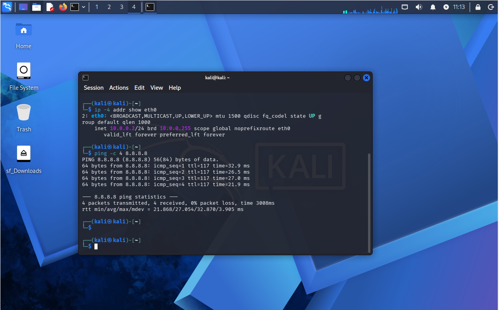
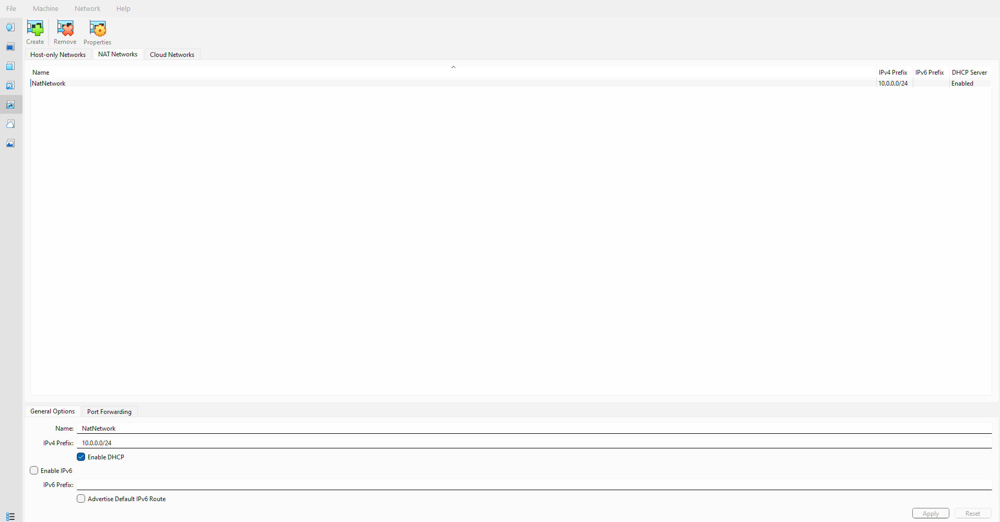
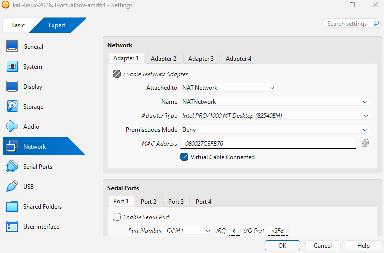
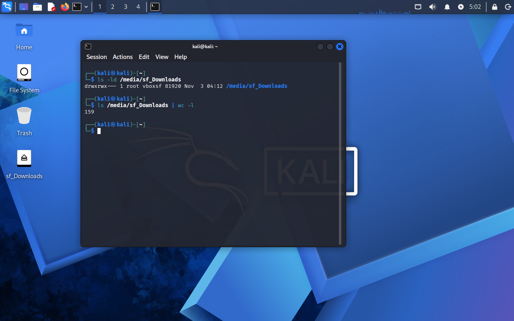
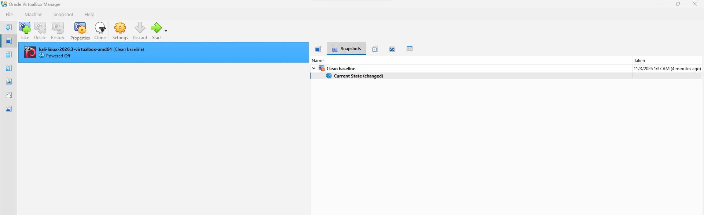

# Cybersecurity Lab Setup: VirtualBox + Kali Linux

An isolated virtual lab for cybersecurity and penetration testing practice, built as part of the Networkwalks internship (Week 1, Project Module 1).

## Objective
Set up a safe testing environment on my PC using VirtualBox and Kali Linux, with a dedicated NAT Network, a static IP, internet access, a shared folder, and a clean snapshot to roll back to.

## Environment
| Item | Value |
|---|---|
| Host OS | Windows |
| Hypervisor | VirtualBox 7.2.22 |
| Attacker VM | Kali Linux 2026.3 |
| Network | NAT Network `NATNetwork`, `10.0.0.0/24` |
| Kali IP | `10.0.0.2/24` |
| Gateway / DNS | `10.0.0.1` |

## Requirements Completed
- [x] VirtualBox as the base
- [x] Kali Linux as the attacking VM
- [x] NAT Network with the 10.0.0.0/24 subnet
- [x] Clipboard and drag and drop enabled (bidirectional)
- [x] Host Downloads folder shared with Kali
- [x] Kali IP address set to 10.0.0.2/24
- [x] Full internet access from Kali
- [x] Snapshot taken (`Clean baseline`)

## Steps Taken
1. Downloaded 7-Zip, VirtualBox and the Kali Linux VirtualBox image.
2. Installed 7-Zip and VirtualBox (after installing the Microsoft Visual C++ Redistributable).
3. Extracted the Kali image and added the VM with **Machine > Add**.
4. Created `NATNetwork` (`10.0.0.0/24`) in VirtualBox and attached Kali's Adapter 1 to it.
5. Enabled bidirectional clipboard and drag and drop, and shared the host Downloads folder.
6. Set a static IP from the terminal:
   ```bash
   sudo nmcli connection modify "Wired connection 1" ipv4.method manual ipv4.addresses 10.0.0.2/24 ipv4.gateway 10.0.0.1 ipv4.dns 10.0.0.1 ipv4.dad-timeout 0
   sudo nmcli connection down "Wired connection 1"
   sudo nmcli connection up "Wired connection 1"
   ```
7. Verified the setup and shut down Kali, then took a snapshot named `Clean baseline`.

## Verification

**Static IP and internet access** (`10.0.0.2/24`, 0% packet loss)


**NAT Network** (`10.0.0.0/24`, DHCP enabled)


**Kali network settings** (Adapter 1 attached to NAT Network)


**Shared folder** (Downloads mounted at `/media/sf_Downloads`; file names omitted for privacy)


**Snapshot** (`Clean baseline`)


## Issues and Fixes
| Issue | Cause | Fix |
|---|---|---|
| VirtualBox would not install | Missing Microsoft Visual C++ Redistributable | Installed `vc_redist.x64`, then reran the VirtualBox installer |
| "Same UUID as an existing virtual machine" when adding Kali | The VM had been registered earlier from its old folder | Right-click the old entry, **Remove Only**, then **Machine > Add** from the new folder |
| Kali kept a DHCP address (`10.0.0.3`) instead of `10.0.0.2` | Restarting the connection does not change its settings, so it stayed on `auto` | Ran `nmcli connection modify` with `ipv4.method manual`, then restarted the connection and checked with `ip -4 addr show eth0` |
| Could not find Network Manager in VirtualBox 7.2 | The menus were reorganized | Found it under the **Resources** icon in the left sidebar |

## Lessons Learned
- **Read the error message before changing anything.** Each problem (the missing Visual C++ runtime, the duplicate UUID, the DHCP address) was explained by the message or command output, and fixing the actual cause was faster than guessing.
- **Restarting a connection does not change its settings.** My first attempt only ran `nmcli connection down` and `up`, so Kali kept a DHCP address (`10.0.0.3`). The fix was `ipv4.method manual` through `nmcli connection modify`, which I confirmed with `ip -4 addr show eth0`.
- **Verify every change with a command.** Checking for `10.0.0.2/24`, a `forever` lease, and ping replies showed that the connection worked.
- **Network isolation matters.** A NAT Network keeps the lab separate from my home network while still giving the VMs internet access, which is the safe setup for practicing security tools.
- **Plan where VM files live.** VirtualBox links to the files where they sit, so moving them after import caused a duplicate-registration error.
- **Snapshots are a safety net.** A clean baseline snapshot lets me experiment freely and roll back in seconds.

## Ethical Use
This lab is for learning only. Security tools must only be used on systems I own or have written permission to test.
